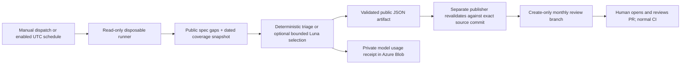

# VM-independent monthly documentation review

## Decision

Use **GitHub Actions now** for public-source review and branch publication.
Use **Azure Container Apps Jobs with Chromium** for a future separately approved
private capture service. Do not port the existing pipeline to Kitesurf yet.

| Option | Fit for nodoc |
| --- | --- |
| GitHub-hosted Actions | Runs the existing Node, Git and Postman tooling on disposable runners. Manual and scheduled execution, branch pushes and normal PR review require no personal VM. Public-repository logs/artifacts must contain public data only. |
| Azure Container Apps Jobs | Suitable for finite containerized jobs, including Node and Chromium, with private Blob storage, Key Vault and managed identity. Jobs can start from CI, a UTC cron schedule or an event. Provisioning and browser authentication need separate approval. |
| Cloudflare Workflows + Browser Run | Viable orchestration alternative: Cron starts a Workflow, private R2 retains evidence, and a container/CI job runs the existing Node/Git toolchain. Workers alone are not a drop-in replacement for the current CLI and filesystem workflow. |
| Kitesurf | Experimental stateless browser on Workers; useful for a compatibility pilot on public pages. Cloudflare explicitly excludes long-running authenticated sessions requiring persistent state. Do not assume Microsoft portal login, service workers, CDP body capture or the recorder extension work unchanged. |

Sources checked November 25, 2026:
[Kitesurf capabilities](https://developers.cloudflare.com/browser-run/kitesurf/),
[open-source deployment](https://blog.cloudflare.com/kitesurf-open-source/),
[Azure jobs](https://learn.microsoft.com/en-us/azure/container-apps/jobs),
[Copilot CLI in Actions](https://docs.github.com/en/copilot/how-tos/copilot-cli/automate-copilot-cli/automate-with-actions).

## Implemented runner

`.github/workflows/monthly-review.yml` has a manual trigger and a monthly cron
at **18:17 UTC on the first**. This is UTC, not a daylight-saving-adjusted local
time. Scheduled execution is **off until `NODOC_MONTHLY_ENABLED=true` is set**.
There is no app automation, Windows scheduled task or self-hosted runner.
GitHub schedules can be delayed or dropped and can be disabled after inactivity
in public repositories. The manual trigger is the recovery path, not a promise
of exactly-once scheduling.



The report includes every current public spec's operation/schema/example counts,
the original published observation assessment, and up to three review candidates.
It does **not** run a portal, invent response bodies, validate endpoints, change
specifications, renew coverage dates or infer minimum roles. Only one candidate
per spec is included in a bounded model packet. Model output can select known
candidate IDs and diagnostic kinds, not introduce arbitrary prose, paths or code.
This is useful triage, not the complete long-term monthly discovery system.

Run locally or in any Node-capable container:

```powershell
npm ci
npm run review:monthly -- --month 2026-11 --output C:\private\nodoc-monthly --reviewer none
```

Use an output directory outside the checkout. The same command on Linux takes
an absolute Linux output path. The public output is `report.json`; a selected
model also writes `model-usage.private.json`, which must not be committed.

### Manual CI execution

In **Actions > Monthly documentation review > Run workflow**, leave
`reviewer=none` and `publish=false` for a credential-free report.
Select `publish=true` to push the report to
`automation/monthly-review-YYYY-MM`. The job returns a compare link.

The publisher uses the built-in `GITHUB_TOKEN` with `contents: write`; it does
not need a stored GitHub write token. It never pushes to main, creates an
approval or enables auto-merge. This repository currently disallows Actions
creating pull requests, so **open the PR yourself from the compare link**.
No repository-wide permission setting is changed. Opening it as a person also
starts ordinary PR checks; pushes made with `GITHUB_TOKEN` do not recursively
trigger workflows.

Identical retries are no-ops. A pre-existing monthly branch with different
content is a visible failure and is left untouched. The create-only Git lease
also refuses a race with another publisher. Review/merge the existing branch;
do not force-overwrite someone's changes to refresh a report.

### Optional Luna and private accounting

For `reviewer=copilot`, configure these repository secrets using the GitHub UI:

- `NODOC_COPILOT_TOKEN`: a dedicated fine-grained token with **Copilot Requests**,
  not a copied desktop login, browser cookie or repository write token.
- `NODOC_USAGE_BLOB_SAS_URL`: HTTPS SAS URL for an existing **private Azure Blob
  container**, scoped to create blobs (`sp=c`, `sr=c`), without read/list
  permission. Use a short appropriate expiry, restrict storage access, rotate
  it, and retain/delete receipts according to your private evidence policy.
  The current uploader supports public Azure's `*.blob.core.windows.net`.

The pinned Copilot CLI runs outside the checkout with isolated configuration,
tools denied, no custom instructions and a three-minute timeout. It uses
`gpt-6-luna` / `xhigh` by default; set `NODOC_MONTHLY_MODEL` to another explicit
available model ID if needed. It never silently falls back to another model.
The CLI's **30-credit soft cap** is a provider-unit ceiling, not dollars or a
hard per-response limit. Invalid output, unavailable model/authentication,
missing usage receipts or storage failure fail the job before publication.

Usage receipts are uploaded under unique `monthly-usage/*.json` blob names with
create-only semantics and no redirects. Raw CLI output and accounting are never
uploaded as public Actions artifacts. Public reports keep USD cost unknown.
Failed jobs may lose ephemeral receipts: diagnose the failure before retrying;
do not interpret the lack of a receipt as zero cost.

To enable recurring runs after reviewing these settings, set
`NODOC_MONTHLY_ENABLED=true` and `NODOC_MONTHLY_REVIEWER=none` or `copilot`.
The schedule then pushes monthly review branches. Remove/set the enabled
variable to `false` to stop it. Activation and private cloud provisioning
are owner decisions; this implementation does neither automatically.

## Private capture design

The [private capture runtime](infra/azure-capture/README.md) now supplies a
container build, bounded adapter to the existing discovery driver, verified
Azure Blob archives/restoration, interrupted-run handling and an independently
approved coverage publisher. It is not deployed and does not create or
authenticate a browser session. Its synthetic recovery exercises do not
replace the signed-in acceptance described below.

Keep portal sessions and raw evidence out of this public repository and its
Actions logs. An Azure job would use an immutable image containing the existing
Node tooling and Chromium, private Blob storage for inputs/checkpoints/outputs,
and Key Vault for GitHub App credentials if private publication requires them.
Use GitHub OIDC for CI-to-Azure access rather than another long-lived cloud key.
Grant narrowly scoped execution permissions: the Jobs start API can override
the image/command, so the ability to start a job is access to its identities and
secrets, not merely a harmless trigger.

Partition work by approved portal/recipe and source digest; persist receipts
before marking work complete, and resume only the unfinished partition. Keep
concurrency at one per signed-in context, apply rate/budget/time limits, and
emit an explicit blocker for expired approval, missing auth, MFA, conditional
access or incomplete capture. Managed identity authenticates to Azure services;
it does **not** replace the portal's user session. Do not weaken MFA, CA or
roles to manufacture unattended access.

After capture, run the existing offline evidence validation, independent review
and public projection. Only approved sanitized aggregates or spec proposals
cross into GitHub. This design still needs provisioning, approved capture inputs
and a Chromium acceptance exercise; neither the offline workflow nor choosing
a cloud platform closes M6.

### Azure infrastructure template

[`infra/azure-capture/`](infra/azure-capture/README.md) contains an undeployed
Bicep template for a manual Container Apps Job and environment, private Blob
container, RBAC Key Vault, scoped managed identity and Log Analytics workspace.
Blob access is authenticated, but the storage and vault endpoints are not
network-isolated. There is no schedule, budget, image, capture runner or
publisher in the template. **Nothing has been deployed.**

Before any deployment the owner must approve the subscription and resource
group, budget and cost alerts, region and network exposure, tenant sign-in/MFA
model, image and execution limits, each capture recipe, secret provisioning and
rotation, and access/retention/publication procedures. The infrastructure README
provides the exact deployment command and teardown guidance. Managed identity
does not authenticate a portal user; do not weaken MFA or conditional access.

The implemented private-capture runtime uploads and restores private evidence
and receipts without logging them, and its separately approved publisher
proposes sanitized coverage reports on a review branch, never directly on main.
Each dated coverage snapshot includes only specifications bound to complete
captures in that refresh. Its totals are scoped to those specifications;
other specifications are shown as unassessed in that snapshot, not as zero.
Earlier snapshots remain dated historical records and are not copied forward.
The existing public monthly workflow does not perform those capture steps.
Deployment and real signed-in acceptance remain outstanding.

## Recovery and VM retirement

The runner, validators, tests and this design live in Git. Public reports pushed
as branches survive runner loss. Public artifacts have 30-day retention, so
download a report or publish it before retention expires. Private accounting
belongs in Azure, not disposable runner storage.

The original offline pilot's reproducible public findings are preserved in
[`reports/pilots/2026-11-25-m365-luna.md`](reports/pilots/2026-11-25-m365-luna.md).
That is not a backup of its exact private runtime receipts. A sender-side
transfer to a private destination was performed, but the receiver's hash has
not been confirmed. Keep the receipts private and verify the received copy
before deleting the old VM.
No portal sessions or VM credentials are required to run the implemented
deterministic CI path.
